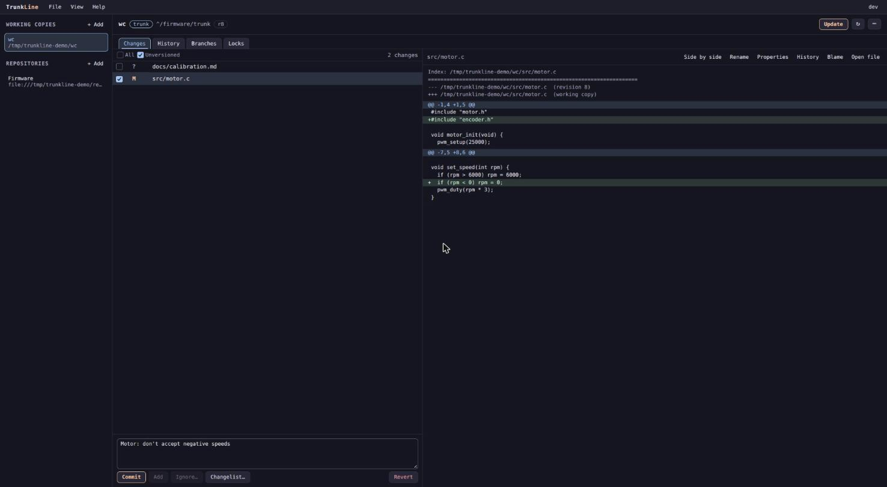
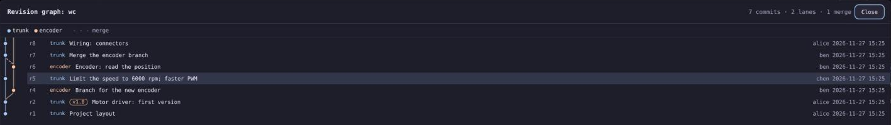
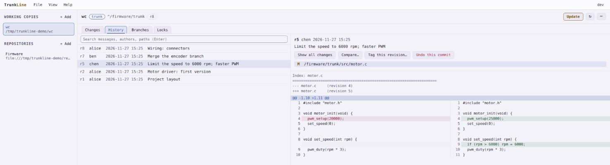

# TrunkLine

A modern desktop client for [Subversion (SVN)](https://subversion.apache.org/),
for Linux and Windows. Free and open source (GPL v3).

TortoiseSVN only runs on Windows and looks its age, and the cross-platform
clients are paid or unmaintained. TrunkLine aims to be a clean, fast client
that works the same on both, built with Go and [Wails](https://wails.io/).







## What it does

New to TrunkLine? [docs/usage.md](docs/usage.md) walks through the everyday
work first, then everything else.

- **Working copies**: a sidebar of your checkouts. Add one you already have, or
  check out from a repository.
- **Changes**: what `svn status` shows, with a diff of the picked file. Tick
  files and commit (Ctrl+Enter). New files and folders are added for you, and
  files deleted from disk are deleted in the repository. You can also revert,
  add and resolve conflicts: in the merge editor, pick mine, theirs or both
  for each conflict or edit it by hand, or resolve whole files (keep mine,
  take theirs, or mark your edited file resolved). A file that still has
  conflict markers (`<<<<<<<`) in it can't be marked resolved or committed by
  accident.
- **Ignore** new files you never want to commit (build output, logs) from the
  Changes list, by name or by extension, in one folder or its subfolders too.
- **Changelists**: group changed files under a name ("login fix") to commit
  them apart from your other changes. The Changes list shows each group under
  a heading whose box ticks the whole group. Changelists stay in your working
  copy; committing a file takes it out of its changelist.
- **Properties**: see and edit a file's or folder's svn properties (line
  endings, needs-lock, ignore lists, externals, your own), with a short
  explanation of each one svn knows. From the diff pane's Properties button,
  or the ⋯ menu for the top folder. Like any change, they're shared by
  committing them. `svn:externals` (folders fetched from elsewhere) is edited
  as a table: URL, revision, folder.
- **Rename or move** a file or folder (the diff pane's Rename button, or the
  ⋯ menu): `svn move`, so its history comes along. Renamed it in a file
  manager instead? The Changes tab spots that (a missing file and a new one
  with the same content, or the same name somewhere else) and records it as
  a rename.
- **Update**, with svn's output shown as it runs. The Update button shows how
  many files changed on the server (checked in the background), and a
  conflict an update causes is pointed out. **Check server** shows what an
  update would bring in without changing anything (`svn status -u`).
- **History**: the log of the working copy's URL, or of one file (History,
  next to Blame). Search it by message, author or changed path. Click a
  revision to see its message and files, and a file to see what that revision
  changed in it. **Undo this commit** takes a revision's changes back out, as
  local changes to check and commit. **Tag this revision…** makes a tag (a
  release, say) of the code as it was then.
- **Compare**: from a revision in History, or any trunk, branch or tag on the
  Branches tab, compare with another revision, the latest, or another branch
  or tag ("what changed since v1.0?"). A window lists the changed files; pick
  one for its diff. Swap turns the comparison round.
- **Patches** (⋯ menu): save the ticked changes as a `.patch` file to send
  someone, or apply one you were sent. Applying checks first and says which
  files it would change and which parts won't fit; those are saved next to
  their file as `.svnpatch.rej`. Patches carry new and deleted files, binary
  files and property changes, and also work with `svn patch` and TortoiseSVN.
- **Side-by-side diffs** (View menu, or the button above a diff): old and new
  next to each other with line numbers, everywhere diffs are shown.
- **Branches**: the Branches tab lists trunk, branches and tags with their
  last change, and the header shows which one you're on. Switch between them
  (your local changes come along; a conflict this causes is pointed out),
  make a new branch or tag from the latest revision or from your working
  copy's, and delete one (it stays in the history). A checkout of a subfolder
  (trunk/src) switches to the same subfolder. Switch to URL covers
  repositories without the trunk/branches/tags layout. If the server's address
  changes (http to https, a new name), **Server moved…** points the working
  copy at it.
- **Revision graph** (View menu, or Graph on the Branches tab): trunk,
  branches, merges and tags over time.
- **Merging**: "Merge into mine…" on the Branches tab lists the commits of
  another branch (or trunk) that you don't have yet. Merge all of them (keep a
  branch up to date with trunk, or bring a finished branch back) or tick just
  some (cherry-pick); svn remembers what was merged, so nothing is merged
  twice. The merge lands as local changes, all ticked, with the commit message
  filled in; Revert undoes it. A merge needs a working copy without other
  changes, and TrunkLine stops a commit that would take the merge record
  without the merged changes.
- **Locks**: lock a file you can't merge (CAD models, Office documents,
  images) before editing it, so nobody else changes it at the same time. The
  Locks tab lists the files that need a lock (svn:needs-lock, read-only until
  locked) and who holds which lock, with their note; locked files are marked
  in the Changes list and the repository browser. Committing releases your
  locks (or tick "Keep my locks"). Taking over or breaking someone else's
  lock asks first.
- **Blame**: who last changed each line of a file, and in which revision, with
  newer changes highlighted. Click a revision for its commit message. Open it
  from a changed file (Blame, next to Open file), or by clicking any file in
  the repository browser. Your uncommitted lines show as "not committed".
- **Repositories**: save a repository URL, browse its folders and check out any
  folder (`trunk`, a branch, a tag). Make a folder, rename or move, delete and
  copy URLs straight in the repository, each as one commit.
- **Only some folders** of a big repository: check out "only the top folder",
  then **Choose folders…** (⋯ menu) to tick the ones to fetch and untick
  ones to leave out of this working copy (they stay in the repository).
- **Notifications**: while TrunkLine isn't in front, a desktop notification
  says when others commit to the working copy you have open (Preferences
  turns it off).
- **Export** (repository browser): just the files of a folder, as a plain copy
  with no link to the repository (`svn export`).
- **Import folder here** (repository browser): commit a folder from your
  computer into a new repository folder (`svn import`). It refuses a folder
  that already has files. By default your folder then becomes the working copy
  (a checkout over it, like TortoiseSVN's "import in place"), so you keep
  working where you were. To take a friend's project into your own repo,
  export it from theirs, then import that folder into yours.
- **Menus** along the top: File (add a working copy or repository,
  Preferences, Quit), View (tabs, unversioned files, theme, zoom) and Help
  (keyboard shortcuts, updates, reporting a problem, About). Alt+F, Alt+V and
  Alt+H open them from the keyboard; F1 lists every shortcut.
- **Preferences** (File menu, or Ctrl+,): a dark or light pastel theme, or
  follow the system's setting; a monospace or regular font (diffs, blame and
  file contents stay monospace); the size (zoom); automatic update checks.
- **Logins**: when a server asks for one, a login dialog opens and the
  operation is retried. The password is kept for the session only and handed
  to svn on stdin. svn caches it too if a secure store is set up (GNOME
  Keyring or KWallet on Linux; the Windows credential store). Servers with a
  company or self-signed certificate ask once whether to trust them.

## Install

Download the latest release from the
[releases page](https://github.com/FrancoCoetzer/TrunkLine/releases):

- **Ubuntu / Debian** (Ubuntu 24.04 or newer): `trunkline_X.Y.Z_amd64.deb`
  (`_arm64.deb` on ARM, such as a Raspberry Pi 5), then
  `sudo apt install ./trunkline_X.Y.Z_amd64.deb` (this also installs svn).
- **Fedora / openSUSE** (Fedora 40 or newer, openSUSE Tumbleweed):
  `trunkline-X.Y.Z-1.x86_64.rpm` (`.aarch64.rpm` on ARM), then
  `sudo dnf install ./trunkline-X.Y.Z-1.x86_64.rpm` (or `sudo zypper install`).
- **Any Linux, as a Flatpak**: `trunkline-X.Y.Z-x86_64.flatpak`
  (`-aarch64.flatpak` on ARM), then
  `flatpak install --user ./trunkline-X.Y.Z-x86_64.flatpak`. svn comes inside
  it; it reaches working copies in your home folder.
- **Any Linux, as a snap**: `trunkline_X.Y.Z_amd64.snap` (`_arm64.snap`), then
  `sudo snap install --dangerous ./trunkline_X.Y.Z_amd64.snap` (`--dangerous`
  because it comes from here rather than the Snap Store). svn comes inside it.
  To let svn save passwords in the keyring:
  `sudo snap connect trunkline:password-manager-service`.
- **Windows**: `trunkline-X.Y.Z-setup.exe`, or `trunkline-X.Y.Z-arm64-setup.exe`
  on an ARM PC (such as a Snapdragon laptop). It installs for your user only
  (no admin rights). Unless a release says it's signed, Windows SmartScreen
  may warn: click **More info**, then **Run anyway**.
- **Windows, as an .msi** (for deployment tools): `trunkline-X.Y.Z-x64.msi`.
  Double-clicked, it installs for that user only, like the setup. For
  everyone on the machine, an administrator runs
  `msiexec /i trunkline-X.Y.Z-x64.msi ALLUSERS=1` (add `/qn` for no windows).

TrunkLine checks for new releases when it starts and every few hours, and
offers to install them (one password prompt on Linux, none on Windows).
A copy installed for all users from the .msi doesn't update itself: it says a
new release exists, and whoever installed it installs the new .msi. Nor do
the Flatpak and the snap (their sandbox doesn't let an app replace itself):
install the new file the same way. Turn
the checks off in Preferences, or check by hand in Help, Check for updates.

## Requirements

TrunkLine uses the real `svn` command-line client, so it behaves exactly like
the command line and works with the same working copies.

- **Linux**: `sudo apt install subversion`
- **Windows**: install [TortoiseSVN](https://tortoisesvn.net/) and tick
  "command line client tools" in its installer (or install SlikSVN). TrunkLine
  finds svn.exe on PATH or in their install folders.

## Building

Needs Go, plus `libgtk-3-dev` and `libwebkit2gtk-4.1-dev` on Linux.

```sh
make            # tests, then build/bin/trunkline
make run        # build and start it
make windows    # build/bin/trunkline.exe (cross-built, no cgo)
make test       # go test ./... (needs svn and svnadmin: the tests use a real repository)
make vet        # Linux and Windows
make dev        # debug build: Inspect in the window, and served on http://localhost:34115
make install-desktop   # a "TrunkLine (dev)" launcher in the app menu
make winres     # redraw the Windows icon and installer pictures (after changing packaging/trunkline.svg; needs Pillow)
make dist TAG=v9.9.9   # a test set of release files in build/dist (needs rpm, nsis and wixl)
```

The frontend has no build step: edit `frontend/dist` and rebuild.

## Releasing

```sh
make release V=v0.2.0 NOTES="Blame view"
```

This tags `main` and pushes the tag. The release workflow
(`.github/workflows/release.yml`) then builds the .deb, the Windows setup and
`SHA256SUMS`, and publishes them as a GitHub release; installed copies offer it
within a few hours. The first line of `NOTES` is what users see in the update
banner. `make dist TAG=v9.9.9` builds the same files locally for testing.

## Layout

| Path | What |
|---|---|
| `main.go` | Wails start-up |
| `app.go` | the methods the window calls (`window.go.main.App.*`) |
| `internal/svn` | runs `svn` and parses its `--xml` output |
| `internal/update` | checks GitHub releases, downloads, verifies and installs updates |
| `internal/config` | saved settings: `~/.config/trunkline/config.json` (`%AppData%\trunkline` on Windows) |
| `frontend/dist` | `index.html`, `app.js`, and `theme.css` |
| `docs` | [usage.md](docs/usage.md) (how to use the app) and the README's screenshots |
| `packaging` | the icon, `dist.sh` (release files), the .deb and .rpm, the Windows setup (NSIS) and .msi (wixl) |
| `.github/workflows` | CI, and the release build |

## Status

Version 0.7. Everything listed under "What it does" works and is tested
against real svn repositories (`make test`). Bug reports and pull requests
are welcome.

## Where it's going

One rule guides every change: **TrunkLine should never get in the way.**
Updating, looking at your changes and committing should take no thought and
no menus. The deeper tools (merging, locks, patches, blame, properties) stay
one click away from where you need them instead of in front of you all the
time. The goal is a client that's quick for everyday work, still has the
deeper tools when a task needs them, and is free on every platform.

What's next, roughly in order:

- **Right-click in your file manager**: Commit, Update, Log, Blame, Lock and
  more from a TrunkLine menu in Nautilus, Dolphin, Nemo, Caja, Thunar and
  PCManFM-Qt, with svn status on files where the file manager allows it.
  "Open with TrunkLine" on folders works in any file manager, and a command
  line (`trunkline commit .`) is there for the terminal.
- **Image diffs**: see what changed in a picture: side by side, a swipe,
  onion skin, or the differences highlighted. For teams with art, designs and
  other binary assets.
- **Big repositories**: fast history and search over hundreds of thousands
  of revisions, and quick status in very large working copies.
- **TortoiseSVN's project settings**: issue-tracker links in History
  (`bugtraq:` properties) and commit message templates and rules (`tsvn:`
  properties), so teams can switch without changing their repositories.
- **macOS**.
- **Signed Windows installers** (no SmartScreen warning) and a TrunkLine
  menu in Explorer.
- **Translations** into other languages.
- **Flathub and the Snap Store**, so those packages update themselves.
- **Subversion 1.15**: once it reaches the distributions, choosing which svn
  TrunkLine uses, and clear messages about working copy formats and old svn
  versions.

Later: shelving (put changes aside and bring them back), Windows 11's
top-level right-click menu, and Finder integration on macOS.

Something missing that you need?
[Open an issue](https://github.com/FrancoCoetzer/TrunkLine/issues).

## License

TrunkLine is free software: you can redistribute it and/or modify it under the
terms of the GNU General Public License, version 3 or (at your option) any
later version. See [LICENSE](LICENSE).
